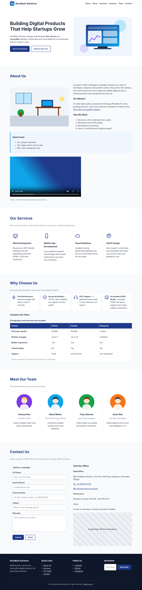
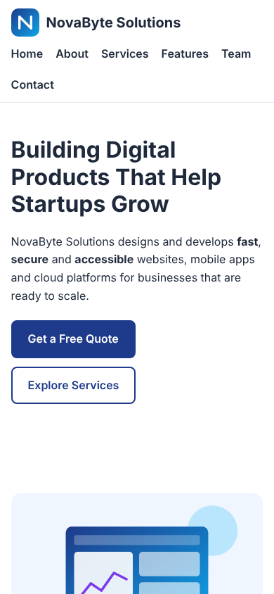

# NovaByte Solutions – CSS3 Styled Responsive Website

**ApexLark Full Stack Development Internship – Day 02 Task**
**Topic:** CSS3 Styling, Flexbox Layouts & Responsive Design
**Intern:** _Your Name_ &nbsp;|&nbsp; **Date:** 03 November 2026

---

## Project Title

**NovaByte Solutions – Official Startup Website (CSS3 Styled & Responsive)**

## Objective

To enhance the Day 01 semantic HTML5 web page with professional CSS3 styling, using an external stylesheet, Google Fonts, Flexbox for all major layouts, and media queries for full responsiveness across desktop, tablet and mobile screens.

## What Changed from Day 01

| Area | Day 01 | Day 02 |
|------|--------|--------|
| Styles | Internal `<style>` block | External `css/style.css` file |
| Layout system | CSS Grid | **Flexbox** throughout |
| Fonts | System fonts only | **Google Fonts** (Inter + Poppins) |
| Visual polish | Minimal | Gradients, shadows, transitions, hover effects |
| Responsive | Single `@media` breakpoint | **3 breakpoints** (992 px, 600 px, 400 px) |
| Colours | 6 CSS variables | 14+ organised CSS custom properties |

## Features Implemented

### CSS3 Techniques Used
- **CSS Custom Properties (Variables)** – 14+ variables for colours, fonts, spacing and shadows
- **Google Fonts** – `Inter` for body text, `Poppins` for headings via `@import` and `<link>`
- **Linear Gradients** – hero background, buttons, table header, footer
- **Box Shadows** – cards, table, form, aside, map iframe
- **Transitions** – smooth hover effects on cards, buttons, links, team avatars
- **Transforms** – `translateY()` on card hover, `scale()` on team avatar hover
- **Backdrop Filter** – frosted-glass effect on the sticky header
- **Border Radius** – rounded corners on cards, inputs, table wrapper, video
- **Text Gradient** – gradient clipped text on the hero `<h1>`
- **Placeholder Styling** – custom `::placeholder` colour

### Flexbox Layouts
| Component | Flexbox Properties Used |
|-----------|------------------------|
| Header | `display: flex; justify-content: space-between; align-items: center; flex-wrap: wrap` |
| Navigation | `display: flex; flex-wrap: wrap; gap` |
| Hero section | `display: flex; align-items: center; gap` with `flex: 1 1 50%` |
| About two-column | `display: flex; align-items: center; gap` |
| Service cards | `display: flex; flex-wrap: wrap` with `flex: 1 1 calc(25% - gap)` |
| Feature list | `display: flex; flex-wrap: wrap` with `flex: 1 1 calc(50% - gap)` |
| Team cards | Same Flexbox card grid as services |
| Contact two-column | `display: flex` two-column layout |
| Footer grid | `display: flex; flex-wrap: wrap` with `flex: 1 1 200px` |
| Newsletter form | `display: flex; gap` |
| Form fieldset | `display: flex; flex-direction: column; gap` |
| Buttons | `display: inline-flex; align-items: center; justify-content: center` |

### Responsive Breakpoints (Media Queries)
| Breakpoint | Target Devices | Key Changes |
|------------|----------------|-------------|
| `≤ 992px` | Tablets | Hero/about stack vertically, cards → 2 per row, features → 1 column |
| `≤ 600px` | Mobile phones | Nav wraps, cards → 1 per row, full-width buttons, footer stacks |
| `≤ 400px` | Small phones | Smaller headings, tighter padding |

## Folder Structure

```
Day-01-HTML/
│
├── index.html                  # Semantic HTML5 page (no inline styles)
├── css/
│   └── style.css               # External CSS3 stylesheet (Flexbox + responsive)
├── README.md                   # Project documentation (updated for Day 02)
├── screenshots/
│   ├── homepage.png            # Full-page screenshot (desktop)
│   └── mobile-view.png         # Mobile screenshot
└── assets/
    ├── images/
    │   ├── hero-illustration.svg
    │   ├── about-office.svg
    │   ├── team-member-1.svg … team-member-4.svg
    │   └── video-poster.jpg
    ├── icons/
    │   ├── logo.svg
    │   ├── web-development.svg, mobile-app.svg, cloud.svg, design.svg
    │   ├── speed.svg, security.svg, support.svg
    │   └── email.svg, phone.svg, location.svg
    └── media/
        └── intro-video.mp4
```

## How to Run

1. Clone the repository:
   ```bash
   git clone https://github.com/<your-username>/Day-01-HTML.git
   ```
2. Open the `Day-01-HTML` folder in **Visual Studio Code**.
3. Open `index.html` in **Google Chrome** (double-click it), or right-click → **Open with Live Server** if you have the Live Server extension.
4. An internet connection is needed for Google Fonts and the embedded Google Map to load.

## CSS Validation

The stylesheet was checked with the **W3C CSS Validation Service** (https://jigsaw.w3.org/css-validator/#validate_by_upload)
by uploading `css/style.css` and fixing every reported issue.

## Screenshot

### Desktop


### Mobile


## Tools Used
- HTML5 & CSS3
- Visual Studio Code
- Google Chrome
- Google Fonts (Inter, Poppins)
- W3C CSS Validator
- Git & GitHub

## Learning Outcomes
- Moved all styles from inline `<style>` to an external `.css` file
- Applied CSS3 techniques: gradients, shadows, transitions, transforms and custom properties
- Built every major layout with Flexbox (`display: flex`, `flex-wrap`, `flex`, `gap`)
- Used Google Fonts for professional typography
- Created three responsive breakpoints using media queries
- Followed professional front-end development and CSS organisation practices

---
© 2026 NovaByte Solutions (fictional company created for the ApexLark internship task).
